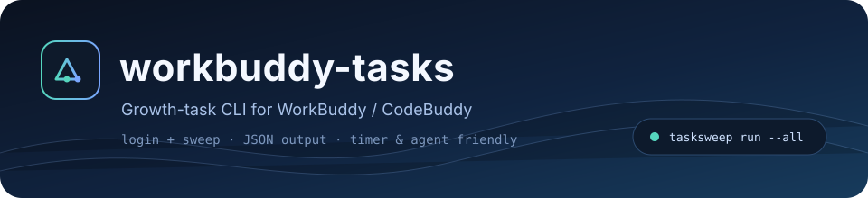
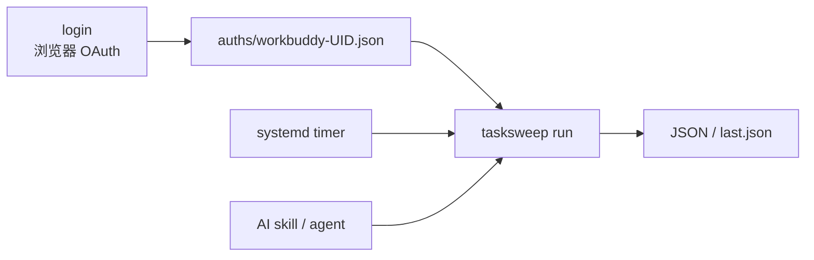

<p align="center">
  
</p>

<p align="center">
  
  
  
  
  <a href="https://github.com/Asanilo/workbuddy-tasks/releases/latest"></a>
</p>

WorkBuddy / CodeBuddy 的成长任务 CLI。读 `auths/`，跑成长任务，自动领奖，输出 JSON。

## 目录

- [特性](#特性)
- [快速开始](#快速开始)
- [命令](#命令)
- [For AI](#给-ai-agent-的约定)
- [定时与自动化](#定时与自动化)
- [配置](#配置)
- [输出](#输出)
- [风险与边界](#风险与边界)
- [开发](#开发)
- [License](#license)

## 特性

| | |
| --- | --- |
| 🎯 **一条命令登录 + 扫荡** | `tasksweep login` 直接跑任务 |
| 🧾 **结构化输出** | stdout 只有 JSON，日志走 stderr；退出码固定，方便脚本和 agent 判断 |
| 🕒 **适合定时** | 提供 systemd user timer 模板，每天自动跑，结果落 `last.json` |

## 快速开始

### 直接下载

从 [Releases](https://github.com/Asanilo/workbuddy-tasks/releases/latest) 拿对应平台的二进制：

```bash
# Linux x86_64
curl -L -o tasksweep https://github.com/Asanilo/workbuddy-tasks/releases/latest/download/tasksweep-linux-amd64
chmod +x tasksweep
```

macOS / Windows / arm64 的资产名：

```text
tasksweep-linux-amd64
tasksweep-linux-arm64
tasksweep-darwin-amd64
tasksweep-darwin-arm64
tasksweep-windows-amd64.exe
checksums.txt
```

校验：

```bash
sha256sum -c checksums.txt
```

### 源码构建

需要 Go 1.22+。

```bash
git clone https://github.com/Asanilo/workbuddy-tasks.git
cd workbuddy-tasks
make build
```

登录直接扫荡：

```bash
./tasksweep login --realm cn --auth-dir ~/.config/workbuddy-tasks/auths --ndjson
```

命令会先打印一个 `login_url`，浏览器打开完成登录，然后自动落盘、自动扫荡。

已经有 auth 文件时，日常只跑扫荡：

```bash
./tasksweep run --all --auth-dir ~/.config/workbuddy-tasks/auths --json
```

先看要做哪些，不执行：

```bash
./tasksweep run --all --auth-dir ~/.config/workbuddy-tasks/auths --dry-run --json
```

## 命令

```text
tasksweep login   登录 + 扫荡（--no-run 只登录）
tasksweep run     对已有 auth 执行扫荡
tasksweep tasks   查询任务列表（只读）
tasksweep list    列出账号和 uid（不访问上游）
tasksweep schema  输出 JSON 结构说明
```

常用示例：

```bash
# 只看账号，拿 uid
tasksweep list --auth-dir ./auths --json

# 查任务（只读）
tasksweep tasks --uid <uid> --include-mp --json

# 预览待办
tasksweep run --uid <uid> --dry-run --json

# 执行
tasksweep run --uid <uid> --json

# 多账号；默认串行，workers > 1 会并发
tasksweep run --all --workers 1 --json

# 每账号一行 JSON
tasksweep run --all --ndjson --quiet
```

退出码：

| 码 | 含义 |
| --- | --- |
| 0 | 全部成功 |
| 1 | 部分账号或任务失败 |
| 2 | 用法错误 |
| 3 | 没有可用账号 |
| 4 | 上游错误（保留） |

## 给 AI agent 的约定

这一节是机器可执行的契约和说明。

**输出**

- stdout：JSON（非 TTY 默认 JSON，也可显式 `--json`）。
- stderr：日志、进度、错误细节。不要把 stderr 当结果解析。
- `--ndjson`：每个账号一行，适合流式读取。

**登录事件**

`login --ndjson` 会按顺序输出：

```json
{"event":"login_url","realm":"cn","url":"https://..."}
{"event":"login_ok","account":{"uid":"...","nickname":"..."},"auth_file":"..."}
{"event":"sweep","sweep":{"uid":"...","status":"ok","results":[...]}}
```

失败时输出 `{"event":"error","error":"..."}`。登录必须由用户在浏览器完成；agent 不要循环重试登录。

**执行顺序**

1. `tasksweep list --json` 拿 `accounts[].uid`。
2. `tasksweep run --uid <uid> --dry-run --json` 看 `pending`。
3. `pending` 为空就结束；不为空再 `run --json`。
4. 解析 `ok`、`accounts[].status`、`accounts[].results[].status`（`done` / `skipped` / `error`）。
5. 用退出码判断整体结果；不要靠关键词猜。

**环境变量**

| 变量 | 用途 |
| --- | --- |
| `TASKSWEEP_AUTH_DIR` | 默认 auth 目录，等价于 `--auth-dir` |
| `TASKSWEEP_REALM` | 默认域，`cn` / `global` |

**不要做的事**

- 不要把 token、auth 文件、面板 key 放进 prompt 或提交到仓库。
- 不要在失败后连续重试；先看 `error`，确认是登录过期、上游限流还是任务协议变化。

## 定时与自动化

日常扫荡不需要 agent 一直在线。用 systemd user timer：

```bash
mkdir -p ~/.config/systemd/user ~/.local/state/workbuddy-tasks
cp deploy/tasksweep.service deploy/tasksweep.timer ~/.config/systemd/user/
systemctl --user daemon-reload
systemctl --user enable --now tasksweep.timer
```

装之前改 `deploy/tasksweep.service`：

```ini
Environment=TASKSWEEP_AUTH_DIR=%h/.config/workbuddy-tasks/auths
Environment=TASKSWEEP_REALM=cn
```

timer 每天 09:05 跑一次，结果写 `~/.local/state/workbuddy-tasks/last.json`，错误写 `last.err`。手动触发：

```bash
systemctl --user start tasksweep.service
cat ~/.local/state/workbuddy-tasks/last.json
```

可选的 skill（`skills/workbuddy-tasks/SKILL.md`），用来让 agent 按需执行或诊断；它不负责定时：

```bash
mkdir -p ~/.dsh/skills
ln -sfn ~/Code/workbuddy-tasks/skills/workbuddy-tasks ~/.dsh/skills/workbuddy-tasks
```

流程大致是这样：



## 配置

| 参数 | 默认 | 说明 |
| --- | --- | --- |
| `--auth-dir` | `auths` | `workbuddy-*.json` 所在目录 |
| `--realm` | `cn` | `cn` / `global` / `all` |
| `--json` | 非 TTY 自动 | 强制 JSON |
| `--ndjson` | false | 每账号一行 |
| `--quiet` | false | 丢弃 stderr 日志 |
| `--uid` | 空 | 指定账号，可逗号分隔 |
| `--all` | false | 全部账号 |
| `--dry-run` | false | 只列待办 |
| `--include-mp` | false | 合并小程序口径任务 |
| `--workers` | 1 | 账号间并发，建议 1 |
| `--timeout` | 5m | 登录等待时间 |
| `--no-run` | false | 登录后不扫荡 |

## 输出

```json
{
  "ok": true,
  "command": "run",
  "generated_at": "2026-10-20T01:00:00+08:00",
  "accounts": [
    {
      "file": "auths/workbuddy-<uid>.json",
      "uid": "<uid>",
      "nickname": "小号",
      "realm": "cn",
      "status": "ok",
      "results": [
        {"task_code": "first_buddy", "status": "done", "message": "已领取"},
        {"task_code": "chat_5", "status": "done", "message": "进度 5/5"}
      ]
    }
  ]
}
```

`results[].status`：`done` / `skipped` / `error`。

## 风险与边界

- 账号可能被风控、限流或封禁；
- 上游协议随时可能改，任务会中断或静默失败；
- 一个账号只能由一个程序负责刷新 token，和多个反代共用会互踢；
- 本工具不提供账号注册、批量养号、转售或托管能力。

只建议副号使用。失败时先看 `accounts[].error` 和 stderr，不要连续重试。

## 开发

```bash
make build          # go build -trimpath -ldflags="-s -w"
make test           # go test ./internal/upstream ./internal/panel
```

目录：

```text
cmd/tasksweep/         CLI：list / login / tasks / run / schema
internal/panel/        任务动作；cli_export.go 是对 CLI 的稳定入口
internal/upstream/     上游协议：任务列表、事件链、领奖、对话
internal/auth/         凭据解析、刷新、原子写回
deploy/                systemd service / timer 模板
skills/                可选的 DSH skill
assets/                README 横幅
```

任务动作来自上游逆向协议。上游改动时，优先看 `internal/upstream/tasks.go` 和 `internal/panel/autotask.go`。CLI 目前会编译完整 `internal/panel`，strip 后约 6.7 MB；后续可以把任务动作拆到 `internal/tasks` 再瘦身。

## License

MIT。保留原项目版权声明，见 [LICENSE](LICENSE) 和 [NOTICE](NOTICE)。

原项目：[linguo2625469/workbuddy2api-panel](https://github.com/linguo2625469/workbuddy2api-panel)
